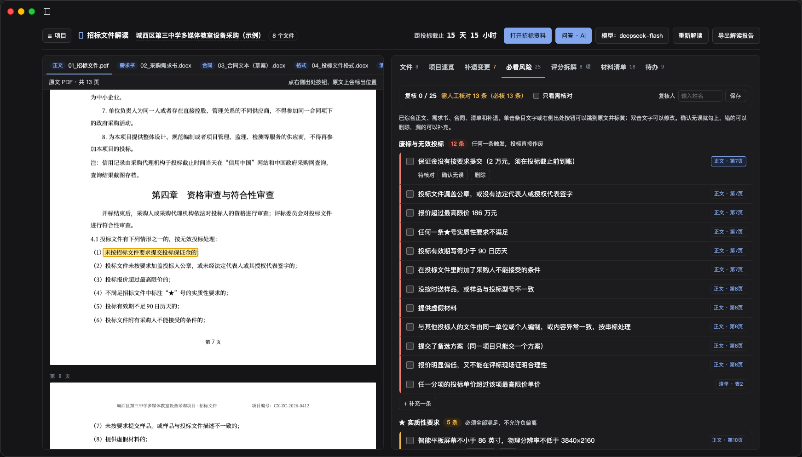
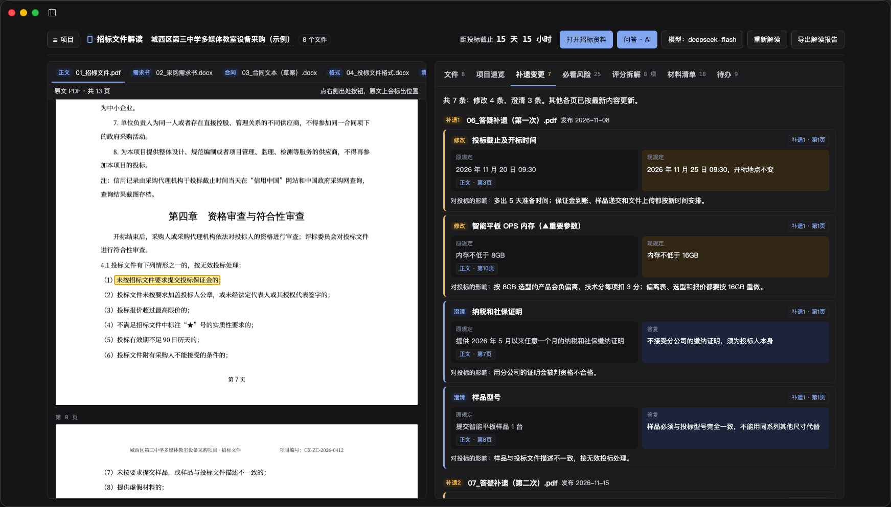
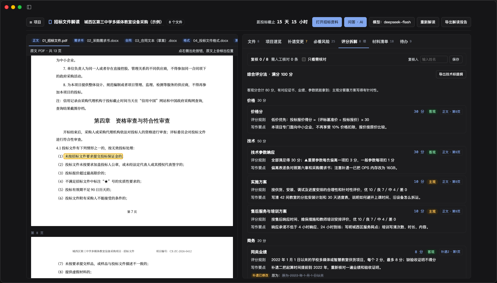
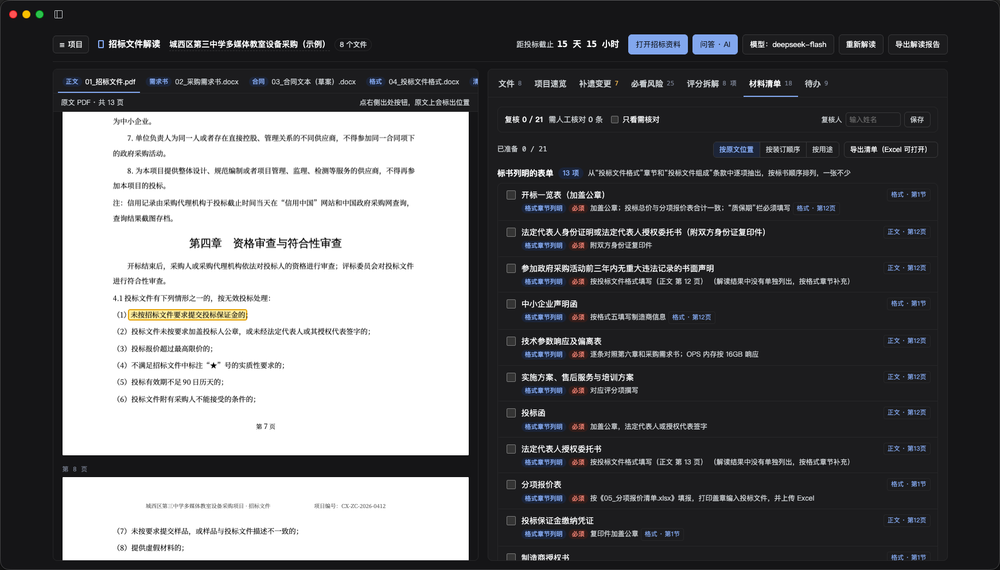

# 招标文件解读 · DSH 工作台

[English](#english)

DSH Desktop 工作台：把一个招标项目的全套资料（招标文件正文、采购需求书、合同、投标文件格式、报价清单、多次答疑补遗、图纸等）放进来，用你在 DSH 里配置的模型解读出结构化结果，每一条结论都带原文出处，点一下就在原文件对应页面标出位置。



| 补遗变更 | 评分拆解 | 材料清单 |
|---|---|---|
|  |  |  |

截图来自 DSH Desktop 0.13.2 中安装的 v0.2.0，使用随包附带的虚构示例项目。

## 功能

- **项目速览**：项目信息、招标人和代理、关键时间、保证金及费用、投标规则、评标和定标、制作与递交等字段，没找到的明确标“未在资料中找到”；可以自定义要解读的栏目。
- **补遗变更**：按发布顺序列出每份答疑补遗改了什么、原规定和现规定、对投标的影响；被改过的速览字段同时显示新值和“原为…”。
- **必看风险**：废标与无效投标、★ 实质性要求、资格条件、合同风险。
- **评分拆解**：评分办法、各项分值和规则、写作要点，以及对评分结构和报价的 AI 解读（算式由程序复算）。
- **材料清单**：标书列明的表单和其他证明材料，可按原文位置或按装订顺序查看。
- **待办**：由已有结果汇总出的准备事项、需要澄清的问题和自查清单。
- **人工复核**：每条结果可确认、修改、删除或补充，记录复核人；导出解读报告（Word）、技术标提纲（Word）、材料清单（CSV）。
- **AI 问答（按需）**：点“问答 · AI”时才在右侧打开 DSH 原生会话，会话的工作区是当前项目的资料文件夹；智能体可用 `bidread_project`、`bidread_search`、`bidread_read`、`bidread_results` 四个只读工具查阅这个项目的原文和解读结果。

支持的文件：PDF（有文字层）、Word（.docx）、Excel（.xlsx）、CSV、网页（.html）、zip 压缩包。旧版 .doc / .xls 需要本机装有 LibreOffice 才能自动转换，否则会提示另存为新格式。

## 使用前须知

- **模型**：通过 DSH 的模型服务（`ctx.llm`）调用，默认用 DSH 的默认模型，也可以在工作台右上角“模型”里另选。工作台本身不保存任何密钥。对思考型模型会选它支持的最低思考强度，避免一次请求耗时数分钟。
- **网络**：除了你在 DSH 里配置的模型服务，工作台不访问其他网络地址；PDF.js、JSZip 都随包分发。
- **数据位置**：项目文件和解读结果保存在 DSH 数据目录下的 `bidread/` 文件夹（`dshHomePath('bidread')`），每个项目一个子文件夹；删除的项目先进入回收站（`bidread/.trash/`），可恢复。
- **准确性**：解读结果由模型生成，可能遗漏或出错。工作台的作用是辅助阅读，请通过出处核对原文，重要事项以招标文件原文为准。

## 已知限制

- 扫描件 PDF（没有文字层的页）暂不支持识别，这些页不参与解读。
- 只在 macOS（Apple Silicon）上的 DSH Desktop 0.13.2 实际安装验证过，其他平台未验证。
- 需要 DSH Desktop 0.13 或更高版本（更早的版本不显示本地或市场工作台）。

## 安装

需要 DSH Desktop 0.13 或更高版本。

- **工作台市场**（收录后）：Workbenches → Market 里搜“招标文件解读”，点 Install。
- **现在就装**：在 DSH Desktop 里新建一个普通会话，把下面这段话发给 AI：

  > 请把 https://github.com/codesstar/dsh-bidread/releases/latest/download/dsh-bidread.tgz 下载到本机，然后用 install_local_workbench 工具安装这个工作台。

  装好后如果提示重启 Harness，按提示重启，再从左上角 Workbenches 切到“招标文件解读”。
- **命令行**：下载上面的 `dsh-bidread.tgz`，运行 `dsh plugin --profile web add ./dsh-bidread.tgz`，然后重启 DSH Desktop。

首次使用前在 DSH 的 Settings → Models 里配好一个模型。

## 目录

```
cordis.patch.yml   把插件加入 DSH 配置，数据目录为 dshHomePath('bidread')
src/index.js       服务端：/api/bidread 下的页面、项目存储、模型代理接口，以及给智能体的工具
src/store.js       项目存储（project.json / state.json / files/ / text.json，回收站）
src/llm.js         通过 ctx.llm 调用模型：选模型、降低思考强度、并发限制、空结果重试、JSON 修正
src/tools.js       智能体工具（只读当前项目）
lib/client.js      客户端面板：整页显示工作台网页，按需在右侧放入 DSH 原生会话
public/app.html    工作台网页（单文件，读取 PDF / Word / Excel、定位出处、展示与导出）
public/vendor/     PDF.js 3.11.174、JSZip 3.10.1
public/sample/     虚构的示例项目资料
```

许可证：MIT。第三方库见 [THIRD_PARTY_NOTICES.md](THIRD_PARTY_NOTICES.md)。

---

## English

A DSH Desktop workbench for reading Chinese public-procurement tender packages. Drop in all documents of one tender (main tender document, requirements, contract, bid formats, price lists, addenda, drawings) and the model configured in DSH extracts a structured reading. Every finding carries a citation that highlights the exact spot in the source file.

- **Overview** of key fields (parties, dates, deposits, bidding rules, evaluation, submission), with user-defined extra fields.
- **Addenda changes** in publication order, showing old and new values.
- **Risks**: disqualification clauses, ★ mandatory requirements, eligibility, contract risks.
- **Scoring breakdown** with points, rules, writing tips and an AI commentary (arithmetic re-checked in code).
- **Materials checklist**, **to-dos**, **human review** (confirm / edit / delete / add, with reviewer name), and Word / CSV exports.
- **On-demand AI chat**: the native DSH conversation opens on the right only when requested; four read-only tools let the agent search and read the current project.

Models are called through DSH (`ctx.llm`); no keys are stored by the workbench and no other network access is made. Data is stored under `dshHomePath('bidread')`. Scanned PDFs without a text layer are not recognized. Verified on DSH Desktop 0.13.2, macOS arm64 only.

License: MIT. See [THIRD_PARTY_NOTICES.md](THIRD_PARTY_NOTICES.md) for bundled libraries.
